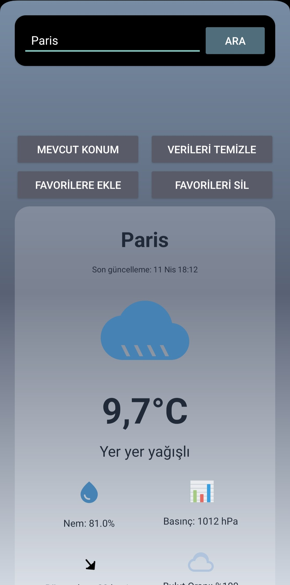
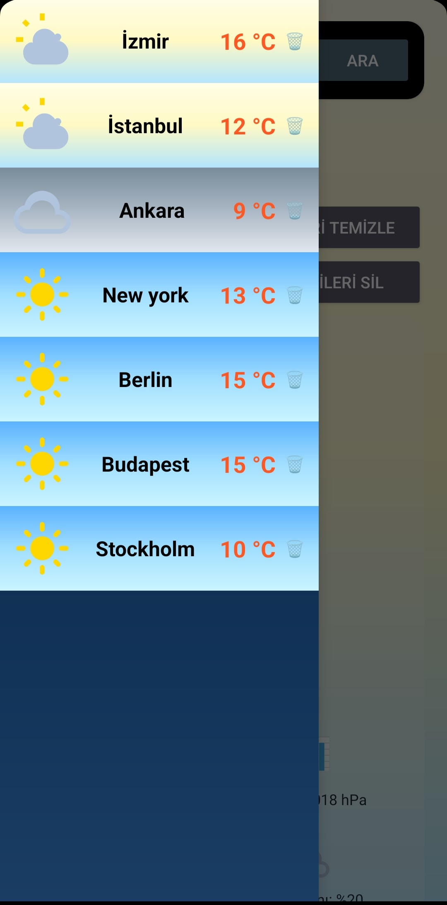
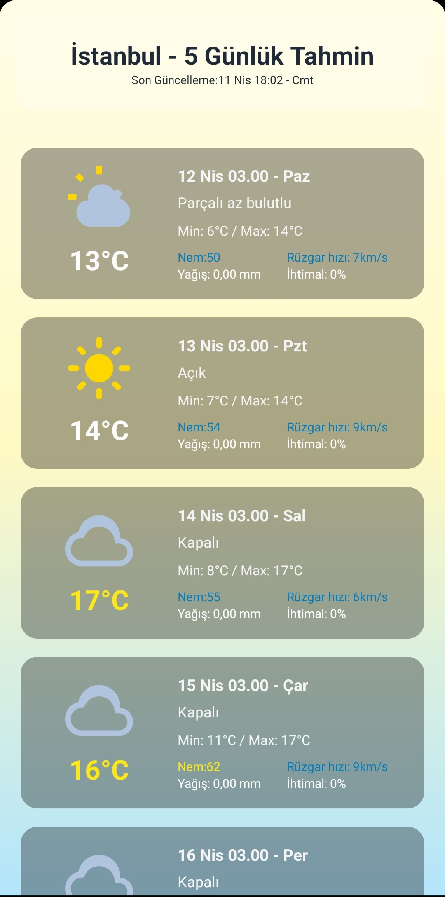
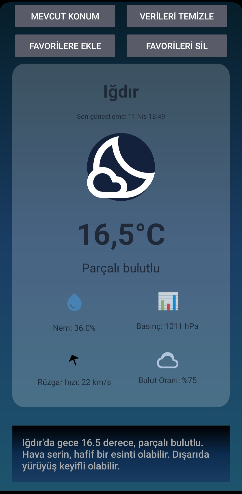

# WeatherApp - Android Hava Durumu Uygulaması

WeatherApp, Java dili ile geliştirilmiş; anlık, saatlik (72 saat) ve 5 günlük hava durumu tahminlerini farklı meteoroloji servislerinden çekebilen, Google Gemini yapay zekası ile kişiselleştirilmiş tavsiyeler sunan ve dinamik ana ekran widget'ı barındıran kapsamlı bir Android uygulamasıdır.

## Temel Özellikler

- Otomatik Konum Belirleme: Cihazın konum servislerini (Fused Location Provider) kullanarak bulunulan konumun hava durumunu otomatik olarak getirir.
- Şehir Arama ve Favoriler: Çevrimdışı SQLite veritabanı üzerinden hızlı şehir arama ve Room Database ile favori şehirleri yerel hafızada saklama.
- 72 Saatlik Saatlik Tahmin: Bulunulan saatten itibaren sonraki 72 saati kapsayan standartlaştırılmış saatlik hava durumu verileri.
- 5 Günlük Detaylı Tahmin: Günlük en düşük, en yüksek sıcaklıklar, yağış ihtimali, rüzgar hızı ve hava koşulu dökümü.
- Dinamik Tematik Arayüz: Hava durumu koduna (açık, bulutlu, yağmurlu, karlı, fırtınalı) ve gece/gündüz durumuna göre otomatik değişen arka planlar ve simgeler.
- Yapay Zeka Destekli Günlük Tavsiye: Google Gemini entegrasyonu ile o anki hava koşullarına (sıcaklık, rüzgar, yağış vb.) göre giyim ve dış mekan aktivite önerileri.
- Ana Ekran Widget'ı: Güncel sıcaklık, nem, rüzgar, basınç göstergeleri ve 6'şar saat aralıklı 5 adet tahmin kartı (+0h, +6h, +12h, +18h, +24h) sunan interaktif widget desteği.
- Arka Plan Senkronizasyonu: Android WorkManager ile periyodik veri güncelleme desteği.

## Desteklenen Hava Durumu Sağlayıcıları

Uygulama, tek bir sağlayıcıya bağımlı kalmadan kullanıcı tercihine göre farklı meteoroloji servislerinden veri alabilecek modüler bir mimariye sahiptir:

- Open-Meteo: API anahtarı gerektirmeyen, doğrudan koordinat tabanlı küresel tahmin servisi.
- Visual Crossing: Küresel model tabanlı detaylı saatlik ve günlük hava durumu servisi.
- WeatherAPI: Güncel hava durumu ve saatlik/günlük tahmin servisi.
- OpenWeatherMap: Küresel hava durumu ve 3 saatlik periyot tahminleri.

Sağlayıcılar arasında geçiş yapıldığında saatlik tahminler daima bulunulan saatten itibaren 72 saat ileriye dönük olacak şekilde ortak veri modeline (`ForecastItem`) dönüştürülür.

## Yapay Zeka Mimarisi (Google Gemini)

Gemini entegrasyonu asenkron arka plan mimarisiyle çalışır. Şehir araması veya konum güncellemesi yapıldığında hava durumu verileri anında arayüze yansıtılır; Gemini tavsiyesi ise arka planda paralel olarak oluşturularak arayüz akışının kesintiye uğraması engellenir.

## Ana Ekran Widget'ı (App Widget)

Android AppWidgetProvider altyapısı üzerine inşa edilen hava durumu widget'ı şunları içerir:

- Şehir adı, güncel sıcaklık, hava durumu açıklaması ve son güncelleme zamanı.
- Nem, rüzgar hızı ve atmosfer basıncı metrikleri.
- 6'şar saat arayla 24 saatlik periyodu gösteren 5 adet tahmin kartı.
- Widget üzerinden tek dokunuşla arka plan verilerini yenileme butonu.
- Widget'a tıklandığında doğrudan ana uygulamayı başlatma işlevi.

## Kullanılan Teknolojiler

- Programlama Dili: Java
- Minimum SDK: 28 (Android 9.0)
- Hedef SDK: 36
- Ağ ve API İstekleri: Google Volley, Retrofit, OkHttp, Gson
- Yerel Veritabanı: Android Room Persistence Library, SQLite
- Konum: Google Play Services Fused Location Provider Client
- Arka Plan Görevleri: Android WorkManager
- Görsel ve Animasyon: Android View Animasyonları, Material Components

## Proje Dizin Yapısı

```text
WeatherAndroidAppwithJava/
├── app/
│   ├── build.gradle.kts           # Uygulama modülü bağımlılık ve derleme ayarları
│   └── src/
│       └── main/
│           ├── AndroidManifest.xml # İzinler, servisler, widget ve aktivite tanımları
│           ├── assets/
│           │   └── weather.db      # Çevrimdışı şehir arama veritabanı
│           ├── java/com/example/weatherapp/
│           │   ├── Activities/     # Ana ekran, saatlik ve günlük tahmin aktiviteleri
│           │   ├── Adapters/       # Liste ve tahmin RecyclerView bağlayıcıları
│           │   ├── data/           # Room Database entity, DAO ve veritabanı sınıfları
│           │   ├── generalFeatures/# Widget sağlayıcısı, SharedPreferences ve bildirim yöneticileri
│           │   └── Helpers/
│           │       ├── AI/         # Google Gemini istemcisi ve tavsiye oluşturucu
│           │       ├── WeatherReceiver/ # Sağlayıcı servisleri (Open-Meteo, Visual Crossing, WeatherAPI, OWM)
│           │       └── location/   # GPS ve konum servis yöneticileri
│           └── res/
│               ├── layout/         # Aktivite ve widget XML arayüz dosyaları
│               ├── drawable/       # Hava durumu ikonları, kart arka planları ve gradyanlar
│               └── values/         # Renkler, temalar ve metin kaynakları
├── build.gradle.kts                # Proje düzeyinde derleme ayarları
├── gradle.properties               # Gradle bellek ve derleme parametreleri
└── local.properties                # Gizli API anahtarlarının tanımlandığı yerel dosya
```

## Kurulum ve Yapılandırma

1. Projeyi klonlayın:
```bash
git clone https://github.com/kullaniciadi/WeatherAndroidAppwithJava.git
```

2. Proje kök dizininde `local.properties` dosyasını oluşturun veya mevcut dosyaya ilgili API anahtarlarınızı ekleyin:
```properties
API_KEY=YOUR_OPENWEATHERMAP_API_KEY
GEMINI_API_KEY=YOUR_GEMINI_API_KEY
weatherAPIKey=YOUR_WEATHERAPI_KEY
visualCrossingKey=YOUR_VISUAL_CROSSING_KEY
```

3. Android Studio ile projeyi açın ve Gradle senkronizasyonunu tamamlayın.
4. Hedef bir emülatör veya fiziksel cihaz seçerek projeyi çalıştırın.

## Ekran Görüntüleri

| Ana Ekran | Favori Şehirler | 5 Günlük Tahmin | Yapay Zeka Tavsiyesi |
| :---: | :---: | :---: | :---: |
|  |  |  |  |
